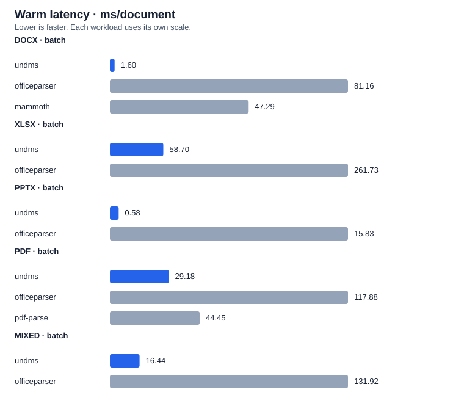
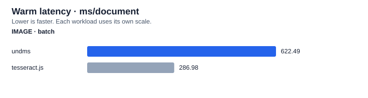

# UNDMS

[](https://github.com/xcvzmoon/undms/actions/workflows/ci.yaml)
[](https://www.npmjs.com/package/undms)

Async document text and metadata extraction for Node.js, built in Rust with napi-rs. Supports plain text, DOCX, XLSX, PPTX, PDF, and images. Image OCR uses ocrs and rten with embedded models.

## Install

Requires Node.js 20 or later.

```sh
pnpm add undms
```

## Extract a document

```ts
import { readFile } from 'node:fs/promises';
import { extract } from 'undms';

const outcome = await extract({
  data: await readFile('report.pdf'),
  name: 'report.pdf',
});

if (outcome.status === 'error') {
  console.error(outcome.error.code, outcome.error.message);
} else {
  console.log(outcome.result.text);
  console.log(outcome.result.metadata);
  console.log(outcome.result.warnings);
}
```

`extract(input, options?)` returns `Promise<ExtractionOutcome>`. Document failures resolve with `status: 'error'`. Invalid arguments, scheduler overload, and infrastructure failures throw or reject. Handle both through `try`/`catch` when needed.

Inputs contain `data: Buffer` and optional `id`, `name`, and `mimeType`. Bytes are copied before processing, so later Buffer mutations cannot change the document. SharedArrayBuffer-backed Buffers are rejected.

## Process a batch

```ts
import { extractBatch } from 'undms';

const batch = await extractBatch(
  [
    { data: Buffer.from('first'), id: 'a', mimeType: 'text/plain' },
    { data: Buffer.from('second'), id: 'b', mimeType: 'text/plain' },
  ],
  { concurrency: 2 },
);

for (const { index, outcome } of batch.items) {
  console.log(index, outcome.status);
}
console.log(batch.summary);
```

Results stay in input order, including duplicate IDs. Each document has its own outcome; a failed document does not discard successful items. Batch budget and infrastructure failures reject the whole request.

## Select work

```ts
import { ExtractionSelection, OcrMode, extract } from 'undms';

const outcome = await extract(
  { data: imageBuffer },
  {
    selection: ExtractionSelection.Metadata,
    ocr: OcrMode.Disabled,
    metrics: true,
  },
);
```

The default selection is both text and metadata, including text statistics. Metadata-only selection skips text extraction and OCR unless `statistics: true` requests text statistics. Text-only selection omits metadata. Import `ExtractionSelection`, `OcrMode`, and `DecodingPolicy` for typed option values.

## Results and limits

Outcomes are a tagged union: `success`, `partial`, or `error`. Successful and partial results contain source identity, optional text/encoding/metadata, warnings, and optional timing metrics. Metadata separates common `properties`, optional `statistics`, and tagged `format` details.

Native work uses bounded CPU workers and a separate image/OCR worker. Per-document and batch limits constrain inputs, outputs, ZIP expansion, archive entry counts, and image pixels. Calamine and lopdf allocate internally; these limits are not a hard process-memory or timeout sandbox.

All per-document limits are positive integers. Byte units are bytes, with 1 MiB = 1,048,576 bytes and 1 GiB = 1,073,741,824 bytes. Maximums are inclusive.

| `ResourceLimits` field |    Default |     Maximum | Measures                                                                                                   |
| ---------------------- | ---------: | ----------: | ---------------------------------------------------------------------------------------------------------- |
| `maxInputBytes`        |     64 MiB |     256 MiB | Original document bytes                                                                                    |
| `maxOutputBytes`       |     16 MiB |     256 MiB | Decoded UTF-8 text, plus estimated result size including metadata, warnings, source identity, and overhead |
| `maxDecompressedBytes` |    128 MiB |       2 GiB | Cumulative actual ZIP bytes inflated by the archive reader or its audit                                    |
| `maxArchiveEntries`    |     10,000 |     100,000 | ZIP entries                                                                                                |
| `maxImagePixels`       | 20,000,000 | 100,000,000 | Image width × height                                                                                       |
| `maxWarnings`          |        100 |       1,000 | Retained warnings; additional warnings are omitted                                                         |

Input, output, and archive expansion are independent budgets. A 200 MB upload may decode to more UTF-8 bytes or expand into a much larger archive. Increasing `maxInputBytes` does not raise the other limits. Text exceeding a budget returns an error; it is not silently truncated. `maxOutputBytes` includes result accounting, so set it above the expected text length. The result estimate is not the serialized JSON size or actual heap usage.

For larger documents, explicitly raise the relevant budgets. For example, use these options with sequential `extract` calls for documents up to 200,000,000 input bytes. Successful extraction still depends on the decoded output, archive expansion, and parser requirements:

```ts
import { extract, getResourceLimitRanges } from 'undms';

const ranges = getResourceLimitRanges();
// Each field has minimum, maximum, and defaultValue in its documented units.
console.log(ranges.maxOutputBytes.maximum); // 268435456

const outcome = await extract(
  { data: documentBuffer, name: documentName },
  {
    limits: {
      maxInputBytes: 200_000_000,
      maxOutputBytes: 256 * 1024 * 1024,
      maxDecompressedBytes: 1024 * 1024 * 1024,
    },
  },
);

if (outcome.status === 'error' && outcome.error.code === 'LIMIT_EXCEEDED') {
  const { limitName, configuredLimit, observedBytes, observedAtLeastBytes, observedValue } =
    outcome.error;
  // Use these fields for admission policy, telemetry, or user-facing size guidance.
}
```

Invalid configuration rejects with `InvalidArg`. A document exceeding its configured budget resolves to an error outcome with stable code `LIMIT_EXCEEDED` and stage `limits`. Configured-budget failures include `limitName` and `configuredLimit`. `observedBytes` is an exact byte count when the complete size is known; `observedAtLeastBytes` is a lower bound when processing stops early (or uses estimated result/storage accounting). Counts and pixel limits use `observedValue`. Measurements are omitted when unavailable; internal allocation or representational failures may have no named configured limit. Consumers should branch on the code and structured fields, not parse the message.

ZIP budgets count bytes read, including repeated entry reads, and stop at the first byte over budget. XLSX extraction audits actual inflation with a fixed scratch buffer before handing the archive to Calamine; it does not trust directory size declarations. Calamine then reads independently, so decompression work can occur twice. An expansion budget does not reserve that amount of memory or guarantee that a parser can process every document within it.

Scheduler admission remains bounded to 32 outstanding requests and 512 MiB of aggregate reservations per loaded native module. A single extraction reserves its accepted input bytes plus configured `maxOutputBytes`. A batch reserves all input bytes + `maxTotalOutputBytes` + effective concurrency × per-document `maxOutputBytes`. The defaults and maximum single-document budgets fit this envelope individually. Concurrent requests and batch combinations can still reject with `OVERLOADED`; reduce concurrency, choose smaller budgets, or process documents sequentially with `extract`. Reservations are retained through native work and JavaScript result conversion, including cancellation and failures. Caller-owned buffers and retained results are outside this accounting.

Batch options have separate inclusive ranges: `maxTotalInputBytes` defaults to 128 MiB and allows up to 256 MiB; `maxTotalOutputBytes` defaults to 64 MiB and allows up to 256 MiB; `maxDocuments` defaults to 1,000 and allows up to 10,000. `concurrency` accepts 1–32, defaults to the CPU worker count, and is clamped to that count (1–4). Batch configuration/input-budget violations reject with `InvalidArg`; exceeding aggregate batch output rejects the whole batch with a message prefixed `LIMIT_EXCEEDED`. Per-document errors remain isolated outcomes with the structured diagnostics above.

Documents exceeding these documented ceilings require preprocessing or splitting outside undms; a streaming extraction API is not currently provided. For a strict process-memory or execution-time boundary, run extraction in a separately constrained process or container. Budget values alone are not memory capacity recommendations.

This package supports native Node.js extraction. Browser and WebAssembly support are outside the scope of this refactor.

## Benchmarks

Tinybench compares eight real government reports, statistical workbooks and training slide decks against officeparser, Mammoth and pdf-parse. The recorded run uses Apple M1, Node v24.21.0, three fresh process rounds per workload, and a separate sustained CPU phase.

Warm milliseconds per document; lower is faster. Singles average the per-file medians equally. Batches contain distinct files and report amortized cost.

| Format / mode | undms | officeparser | mammoth | pdf-parse |
| ------------- | ----: | -----------: | ------: | --------: |
| DOCX · single |  2.04 |        79.31 |   45.48 |         — |
| XLSX · single | 61.56 |       278.41 |       — |         — |
| PPTX · single |  0.74 |        14.39 |       — |         — |
| PDF · single  | 37.34 |       165.73 |       — |     44.39 |
| DOCX · batch  |  1.60 |        81.16 |   47.29 |         — |
| XLSX · batch  | 58.70 |       261.73 |       — |         — |
| PPTX · batch  |  0.58 |        15.83 |       — |         — |
| PDF · batch   | 29.18 |       117.88 |       — |     44.45 |
| MIXED · batch | 16.44 |       131.92 |       — |         — |



CPU utilization is measured from OS process counters: 100% means one occupied core. [CPU, memory, methodology and provenance](benchmark/published/report.md) · [Raw measurements](benchmark/published/results.json). This is a small corpus; output policies differ and the results do not establish an accuracy ranking.

Reproduce with `pnpm bench:packages`, or use `--corpus manifest.json` for your own documents. See [benchmark instructions](benchmark/README.md).

### Image OCR

Three real SROIE receipt scans are compared against Tesseract.js using reusable workers and reference transcriptions. This run uses ocrs balanced mode and Tesseract English LSTM best_int, with three fresh process rounds per workload.

Warm milliseconds per image; batch values are amortized across the three distinct receipts.

| Format / mode  |  undms | tesseract.js |
| -------------- | -----: | -----------: |
| IMAGE · single | 576.90 |       634.14 |
| IMAGE · batch  | 622.49 |       286.98 |



On these receipts, undms has lower average single-image latency; Tesseract.js has lower batch latency and lower character/word error rates on all three images. Native OCR uses a serial lane while Tesseract reuses up to three workers for this batch. The configurations differ, and this small corpus does not establish a general OCR ranking.

[Per-image accuracy, CPU, memory, cold starts and cleanup](benchmark/published/images/report.md) · [Raw measurements](benchmark/published/images/results.json). Reproduce with `pnpm bench:ocr`; use `pnpm bench:packages --images` to include images alongside the document suite.

## Develop

Use pnpm and a stable Rust toolchain.

```sh
pnpm install
pnpm build
pnpm test
pnpm lint
vp run fmt
```

Compare this workspace with the active published release using `pnpm bench:compare`, or with other Node.js extraction packages using `pnpm bench:packages`. See [benchmark instructions](benchmark/README.md) for version selection, OCR, workload filtering, and generated reports.

Generated bindings and TypeScript declarations come from the Rust API; edit the Rust source to change them. Native targets cover macOS, Windows, and Linux as configured in `scripts/napi.config.ts`. The TypeScript wrapper in `scripts/napi.ts` passes a temporary JSON config to napi and generates platform packages named `@undms/<platform>`. Use `pnpm run create-npm-dirs` to generate package manifests; build, artifact, and version scripts use the same wrapper.

## Release

Run `pnpm release --dry-run` to preview the configured major release, then `pnpm release` to bump the Node package and Rust crate, write the changelog, commit, tag, and push. GitHub release creation is enabled; provide `GENBUMPPUSH_GITHUB_TOKEN` through the environment. Release commits using `release: v<version>` trigger CI; `.github/workflows/publish.yaml` publishes the tested native packages using npm trusted publishing after CI succeeds. Configure each package's trusted publisher before releasing; see [.github/RELEASING.md](.github/RELEASING.md).

## License

MIT
